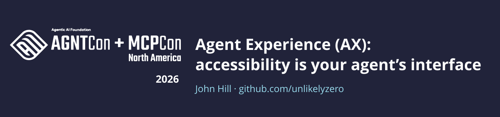

<div align="center">



[](https://events.linuxfoundation.org/agntcon-mcpcon-north-america/)
[](https://aaif.io/)

[](https://modelcontextprotocol.io)
[](https://www.w3.org/TR/WCAG22/)
[](https://www.w3.org/WAI/ARIA/apg/)
[](https://github.com/unlikelyzero/agent-experience-mcpcon26/actions/workflows/tiers.yml)

**The same agent, doing the same task, on the same pixels, does better as the markup gets more accessible.**

[Results](#evals-are-the-outcome) · [Run it](#run-every-app-in-every-tier) · [Design](docs/DESIGN.md) · [Poster source](poster/)

</div>

## One UI, four views

The two builds below render the same pixels. A person sees the same chat box in both. An agent driving the browser sees two different apps, because it works from the accessibility tree, not the screenshot.

The task, in both builds: *send my message, then confirm it was saved.*

| View | What it shows | Size of one real page (1280×800) |
|:---|:---|---:|
| Screenshot | What a person or a vision model sees | ≈1.4k tokens · 97 KB |
| DOM | What the browser holds | ≈101k tokens · 404 KB |
| Accessibility tree | What a browser agent reads | ≈13k tokens · 51 KB |
| Screen reader | Tab order and live-region announcements | heard, not read |

<table>
<thead>
<tr>
<th width="50%" align="left">Div soup</th>
<th width="50%" align="left">WCAG</th>
</tr>
</thead>
<tbody>
<tr>
<td>

```html
<div class="x9k2">
  <textarea placeholder="Message…">
  <div (click)="send()">
    <svg>…</svg>
  </div>
</div>
<div class="toast">Saved</div>
```

</td>
<td>

```html
<form aria-label="Compose">
  <textarea aria-label="Message">
  <button aria-label="Send message">
    <svg>…</svg>
  </button>
</form>
<div role="status">Saved</div>
```

</td>
</tr>
<tr>
<td>

```yaml
- generic
  - textbox "Message…"
  - generic
    - img
- generic: Saved
```

</td>
<td>

```yaml
- form "Compose":
  - textbox "Message"
  - button "Send message"
- status: Saved
```

</td>
</tr>
<tr>
<td valign="top">

The placeholder is the only name the box has. Nothing is called Send and it can't take focus, so the agent has to guess at `div.x9k2 > div:nth-child(2)`. "Saved" is never announced.

</td>
<td valign="top">

The agent clicks `getByRole('button', { name: 'Send message' })`, and the status region announces "Saved" without anyone moving focus to it.

</td>
</tr>
</tbody>
</table>

## Three tiers

Each tier is a patch on a real open-source app that changes markup and nothing else. Screenshots are compared byte for byte across tiers, so whatever the agent does differently, it does because of what it can read.

| Tier | Definition |
|:---|:---|
| Div soup | No accessible names, roles or state. Controls are clickable `<div>`s. |
| WCAG / Section 508 | No axe violations tagged WCAG 2.x A or AA. This is the compliance bar most teams ship to. |
| 100% accessibility patterns | WCAG, plus WAI-ARIA Authoring Practices for every widget a task touches, plus hints for agents: controls named for what they act on, descriptions, stable ids. |

## Results

**what-iff**, Memory Manager. Four tasks, three runs of each task per tier per model, driven through Playwright MCP. Every run is graded by reading the app's state through its API; the agent's own claim of success isn't trusted. Costs are list prices.

### What existing evals see

| Signal | Div soup | WCAG / 508 | Patterns |
|:---|---:|---:|---:|
| axe violations tagged WCAG A/AA | 22 | 0 | 0 |
| what-iff's own role-based UI tests passing | 5 / 26 | 26 / 26 | 26 / 26 |
| Screenshots identical to WCAG | yes | — | yes |

### What agents see

<table>
<thead>
<tr>
<th rowspan="2" align="left">Model</th>
<th colspan="3">Tokens per successful task</th>
<th colspan="3">Cost per successful task</th>
<th colspan="3">Tool calls per run</th>
</tr>
<tr>
<th align="right">Div soup</th><th align="right">WCAG</th><th align="right">Patterns</th>
<th align="right">Div soup</th><th align="right">WCAG</th><th align="right">Patterns</th>
<th align="right">Div soup</th><th align="right">WCAG</th><th align="right">Patterns</th>
</tr>
</thead>
<tbody>
<tr>
<td>Claude Opus 5.5</td>
<td align="right">348k</td><td align="right">301k</td><td align="right"><b>278k</b></td>
<td align="right">$0.29</td><td align="right"><b>$0.26</b></td><td align="right">$0.28</td>
<td align="right">20.2</td><td align="right">19.3</td><td align="right"><b>16.9</b></td>
</tr>
<tr>
<td>Claude Sonnet 5.5</td>
<td align="right">402k</td><td align="right">329k</td><td align="right"><b>312k</b></td>
<td align="right">$0.19</td><td align="right"><b>$0.16</b></td><td align="right"><b>$0.16</b></td>
<td align="right">19.1</td><td align="right">17.3</td><td align="right"><b>15.8</b></td>
</tr>
<tr>
<td>Claude Haiku 4.5</td>
<td align="right">2.14M</td><td align="right">1.10M</td><td align="right"><b>922k</b></td>
<td align="right">$0.41</td><td align="right">$0.25</td><td align="right"><b>$0.22</b></td>
<td align="right">37.3</td><td align="right">26.7</td><td align="right"><b>24.4</b></td>
</tr>
<tr>
<td>Claude Haiku 5.5</td>
<td align="right">626k</td><td align="right"><b>511k</b></td><td align="right">626k</td>
<td align="right">$0.015</td><td align="right"><b>$0.013</b></td><td align="right">$0.015</td>
<td align="right">24.3</td><td align="right"><b>20.3</b></td><td align="right">23.8</td>
</tr>
</tbody>
</table>

<sub>Lowest value in each group in bold.</sub>

| All four models | Div soup | WCAG / 508 | Patterns |
|:---|---:|---:|---:|
| Tasks completed | 90% | 98% | 100% |
| Claimed done, but wasn't | 2 | 0 | 0 |

### Reading the results

Div soup made every model work harder for the same outcome. Against WCAG it cost Opus 16% more tokens per success, Sonnet and Haiku 5.5 22% more, and Haiku 4.5 95% more. Haiku 4.5 also fell back on screenshots there and twice reported success on tasks it hadn't finished.

axe scores WCAG and patterns identically, at zero. The agents could tell them apart: patterns cut tokens by a further 5–16% for Opus, Sonnet and Haiku 4.5. Haiku 5.5 is the exception. On these tasks it did no better with patterns than with WCAG.

Per-run data and the study's limits, including why one task was excluded, are in [`results/published/what-iff`](results/published/what-iff/README.md).

## Takeaway

**Accessibility is for people first. Agents benefit too.** The names, roles and state that blind and low-vision people rely on through screen readers are the same interface a browser agent reads. Build it properly for people and agents can use it as well.

## Apps

| App | Stack | Status |
|:---|:---|:---|
| [what-iff](https://github.com/theimaginaryfoundation/what-iff) | AI assistant · Angular, Go | Measured across all three tiers with four models. Tiers, seed, graders and runner are on the [`ax-tiers`](https://github.com/neupenguin/what-iff/tree/ax-tiers) branch of a fork. |
| [Headlamp](https://github.com/kubernetes-sigs/headlamp) | Kubernetes UI · React, MUI | All three tier patches, kubectl graders for five tasks, pixel and axe gates. Agent runs in progress. |
| [Open MCT](https://github.com/nasa/openmct) | Mission control · Vue | Build and serve, CouchDB graders for five tasks. Tier patches in progress. |

## Run every app in every tier

Needs Node 22+, git and Docker; Headlamp also needs kind and kubectl. Build the
harness once:

```bash
npm ci && npm run build
alias ax='node dist/harness/src/cli.js'
```

| App | Div soup | WCAG / 508 | 100% patterns |
|---|---|---|---|
| Headlamp | `ax serve --app headlamp --tier div-soup` → http://localhost:4466 | `--tier wcag` → http://localhost:4467 | `--tier patterns` → http://localhost:4468 |
| Open MCT | `ax serve --app openmct --tier div-soup` → http://localhost:8090 | `--tier wcag` → http://localhost:8091 | `--tier patterns` → http://localhost:8092 |
| what-iff | http://localhost:4200/memories?ax=3 | http://localhost:4200/memories?ax=0 | http://localhost:4200/memories?ax=4 |

Until their patches land, Open MCT's WCAG and patterns tiers serve the app as
shipped.

### Headlamp

```bash
kind create cluster --config apps/headlamp/cluster/kind.yaml
ax prepare --app headlamp            # pinned clone + one worktree per tier
ax seed --app headlamp               # shop-prod and shop-staging fixtures
ax serve --app headlamp --tier wcag  # Ctrl-C stops and removes the container
ax grade --app headlamp --task H1    # after doing the task in the browser
ax eval pixels --app headlamp        # every tier byte-identical, or exit 1
ax eval axe --app headlamp           # WCAG-tagged violations per tier
```

### Open MCT

```bash
ax prepare --app openmct
ax seed --app openmct                # starts CouchDB on :5984 and seeds it
ax serve --app openmct --tier div-soup
ax grade --app openmct --task O1
```

### what-iff

what-iff runs from the [`ax-tiers`](https://github.com/neupenguin/what-iff/tree/ax-tiers)
branch of a fork, where one build serves every tier through `?ax=N`:

```bash
git clone -b ax-tiers https://github.com/neupenguin/what-iff.git && cd what-iff
cp .env.example .env
for v in JWT_SECRET JWT_REFRESH_SECRET TOKEN_ENCRYPTION_SECRET; do echo "$v=$(openssl rand -hex 32)" >> .env; done
echo AUTO_MIGRATE=true >> .env
make db-up && make generate
make run-mock                        # API on :8080 with the mock LLM; leave running
cd web/app && npm ci && npm start    # app on :4200; in a second terminal
```

Then, from `web/app/`:

```bash
# axe, role-based specs and pixel identity, one Playwright project per level
npx playwright test --config e2e/ax-demo/playwright.config.ax-levels.ts \
  --project=axe-ax3 --project=axe-ax0 --project=axe-ax4 \
  --project=functional-ax3 --project=functional-ax0 --project=functional-ax4

# agent runs: tiers as levels 3,0,4; needs a signed-in `claude` CLI
npx tsx e2e/ax-demo/run.ts --levels 3,0,4 --drivers playwright-mcp \
  --tasks T1,T2,T3,T5 --runs 3 --model sonnet --max-budget-usd 1
```

The runner's own README is `web/app/e2e/ax-demo/README.md` on that branch. To
publish a run, merge its CSVs with `apps/what-iff/export-runs.mjs` and
summarize with `apps/what-iff/summarize.mjs`.

## Layout

```
docs/DESIGN.md            design, tiers, tasks, metrics, build order (source of truth)
harness/src/              the `ax` CLI: prepare, diff, patches, serve, seed, grade, eval
apps/<app>/               adapter, fixtures, graders and tiers/<tier>.patch per app
results/published/        the numbers the poster quotes, with per-run CSVs
poster/                   source of the printed poster and its render script
```
